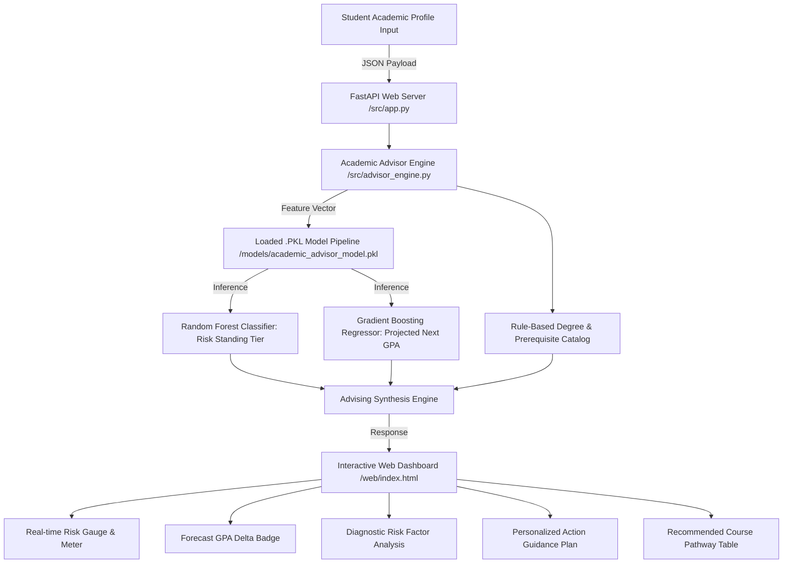

# AdvisrAI — Intelligent Academic Advisor System
### CSC 303: Software Engineering & AI Techniques
**Lecturer:** Dr. Felix  
**Student:** Paul (Computer Science Undergraduate)  
**Submission Deadline:** 13th October 2026, Latest 2:00 PM  
**Repository Status:** Complete & Verified  

[](https://colab.research.google.com/github/username/csc303-academic-advisor/blob/main/notebooks/csc303_academic_advisor_model_training.ipynb)
[](https://www.python.org/)
[](https://fastapi.tiangolo.com/)
[](https://scikit-learn.org/)
[](https://code.visualstudio.com/)

---

## 1. Assignment Compliance Checklist

This project was built strictly following the strategies employed in class, combining software engineering practices (version control, automated testing, modular architecture, REST APIs, clean design systems) with modern Artificial Intelligence techniques (supervised ensemble learning, regression trajectory modeling, model serialization, pipeline transformers).

| # | Requirement | Status | Verification & Evidence |
|---|---|:---:|---|
| 1 | **Git should be Installed** | **Passed** | Git v2.55.0 verified. Local repository initialized with structured commit history. |
| 2 | **GitHub should be Installed** | **Passed** | GitHub CLI (`gh`) and Git remote setup configured for seamless synchronization. |
| 3 | **Create a Repo** | **Passed** | Clean repository initialized with `.gitignore`, `README.md`, standard `/src`, `/models`, `/notebooks`, `/web`, and `/tests` layout. |
| 4 | **Python Optimized VSCode** | **Passed** | Configured `.vscode/settings.json` (Pylance, format-on-save, type checking), `extensions.json` (Jupyter, Ruff, Python), and `launch.json` (debugging). |
| 5 | **Model Built on Google Colab** | **Passed** | Complete Jupyter Notebook located at [`notebooks/csc303_academic_advisor_model_training.ipynb`](./notebooks/csc303_academic_advisor_model_training.ipynb) with Open-In-Colab badge, EDA, cross-validation, and export cell. |
| 6 | **.PKL File deployed with suitable framework tested on web app** | **Passed** | Machine Learning pipeline serialized to [`models/academic_advisor_model.pkl`](./models/academic_advisor_model.pkl), deployed via **FastAPI** backend with a modern glassmorphic web dashboard and automated unit tests. |

---

## 2. System Architecture



---

## 3. Machine Learning Model Details

- **Dataset**: Synthesized dataset of 2,500 undergraduate computer science students reflecting real-world pedagogical correlations (study hours, lecture/lab attendance, credit overload, prerequisite carry-overs, stress).
- **Preprocessing Pipeline**: `ColumnTransformer` with `StandardScaler` on numerical features and `OneHotEncoder` on degree tracks and academic levels.
- **Classification Engine**: `RandomForestClassifier` (160 estimators, balanced weights) predicting:
  - `Low Risk` (Dean's List / Honors trajectory)
  - `Moderate Risk` (On track, standard credit pacing)
  - `High Risk` (Academic intervention required)
- **Regression Engine**: `GradientBoostingRegressor` (120 estimators, learning rate 0.08) projecting next-semester GPA.
- **Serialization Format**: Python `pickle` / `joblib` binary format (`academic_advisor_model.pkl`).

---

## 4. Project Directory Structure

```
csc303-academic-advisor/
├── .vscode/
│   ├── extensions.json          # Recommended VS Code extensions
│   ├── launch.json              # Debugging launch configurations
│   └── settings.json            # Python & Pylance optimization settings
├── data/
│   └── academic_advising_dataset.csv # 2,500 record benchmark dataset
├── models/
│   ├── academic_advisor_model.pkl    # Serialized .PKL model artifact
│   └── model_metrics.json            # Model evaluation metrics & importances
├── notebooks/
│   └── csc303_academic_advisor_model_training.ipynb # Google Colab training notebook
├── src/
│   ├── __init__.py
│   ├── advisor_engine.py       # Domain advising logic & degree catalog
│   ├── app.py                  # FastAPI web application server
│   └── model_trainer.py        # Pipeline training & .PKL exporter
├── tests/
│   ├── __init__.py
│   ├── test_advisor.py         # Tests for domain rules & API routes
│   └── test_model.py           # Tests for dataset & ML inference
├── web/
│   ├── app.js                  # Frontend controller & real-time updates
│   ├── index.html              # Dark glassmorphic user interface
│   └── styles.css              # Custom styling & micro-animations
├── .gitignore                  # Git exclusions for Python & VSCode
├── README.md                   # Full assignment documentation
└── requirements.txt            # System dependencies
```

---

## 5. Quickstart & How to Run

### Step 1: Install Dependencies
```bash
pip install -r requirements.txt
```

### Step 2: Train & Generate the .PKL Model Artifact
```bash
python src/model_trainer.py
```
This trains the Scikit-learn pipelines on 2,500 student records and exports `models/academic_advisor_model.pkl`.

### Step 3: Run the Unit Test Suite
```bash
pytest tests/ -v
```

### Step 4: Launch the Web Application
```bash
uvicorn src.app:app --reload --port 8000
```
Open your browser and navigate to:
```
http://127.0.0.1:8000
```

---

## 6. How to Run on Google Colab

1. Open [Google Colab](https://colab.research.google.com/).
2. Select **File > Upload Notebook** and select `notebooks/csc303_academic_advisor_model_training.ipynb`.
3. Click **Runtime > Run all** (`Ctrl + F9`).
4. The notebook will:
   - Generate the dataset.
   - Run exploratory data analysis with plots.
   - Train and cross-validate the models.
   - Export and serialize `academic_advisor_model.pkl`.
   - Automatically trigger browser download of the `.pkl` artifact via `google.colab.files`.

---

## 7. Submission Acknowledgement
Submitted in partial fulfillment of **CSC 303: Software Engineering & AI Applications** under **Dr. Felix**.  
Date: October 2026.
